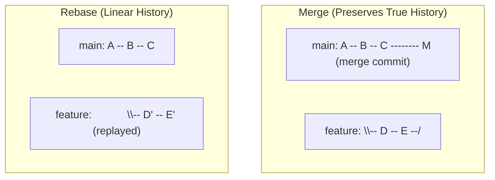

# Git - Essential Commands & Workflows

A practical guide and cheatsheet for daily Git operations, branching workflows, remote syncing, and history management (merge vs. rebase).

---

## 1. Branch Management

### Create & Switch Branches
```bash
# Modern approach (recommended): create and switch to a new branch
git switch -c feature/my-feature

# Traditional approach
git checkout -b feature/my-feature

# Switch between existing branches
git switch main
git checkout main

# Switch to the previous branch you were on
git switch -
```

### Inspect, Rename & Delete Branches
```bash
# List local branches (* marks current branch)
git branch

# List both local and remote tracking branches
git branch -a

# Rename current branch
git branch -m new-branch-name

# Delete local branch (safe: checks if merged)
git branch -d feature/my-feature

# Force delete local branch (unmerged changes)
git branch -D feature/my-feature

# Delete remote branch
git push origin --delete feature/my-feature
```

---

## 2. Staging & Committing

```bash
# Check working tree status
git status -s

# Stage specific files or all modifications
git add path/to/file.py
git add .

# Interactive staging (stage specific hunks)
git add -p

# Commit staged changes
git commit -m "feat: add user authentication endpoint"

# Amend the last commit (edit message or add forgotten staged files)
git commit --amend --no-edit
```

---

## 3. Remote Tracking & Pushing

### Push a New Branch for the First Time
When pushing a branch that does not exist on remote yet, set upstream (`-u`):
```bash
# Push current branch and set upstream tracking to origin
git push -u origin feature/my-feature

# Shortcut if branch name matches:
git push -u origin HEAD
```

> [!TIP]
> Run `git config --global --add --bool push.autoSetupRemote true` once on your machine. Afterward, a simple `git push` on any new branch automatically creates the remote branch and links tracking.

### Syncing Remote Changes
```bash
# Download commits and refs from remote without modifying working directory
git fetch origin

# Fetch and integrate remote changes into current branch
git pull

# Pull using rebase instead of merge (keeps history linear)
git pull --rebase origin main

# Remove local references to deleted remote branches
git fetch --prune
```

---

## 4. Rebase vs. Merge

### Concept Comparison



| Feature | `git merge` | `git rebase` |
| :--- | :--- | :--- |
| **History** | Non-linear, shows branch forks & join points | Linear, clean, single timeline |
| **Merge Commit** | Creates a new merge commit (unless fast-forward) | No merge commit, replays commits on top |
| **Commit Hashes** | Preserves original commit hashes | Rewrites commit hashes (`D -> D'`) |
| **Safety** | Safe for shared / public branches | **Never** rebase branches shared with others |

### Workflow A: Merging Feature into Main
```bash
# 1. Switch to target branch
git switch main

# 2. Update local main
git pull

# 3. Merge feature branch
git merge feature/my-feature

# 4. Push updated main
git push origin main
```

### Workflow B: Rebasing Feature onto Main
Use this to bring latest `main` changes into your feature branch cleanly before opening a PR:
```bash
# 1. Switch to your feature branch
git switch feature/my-feature

# 2. Fetch latest changes
git fetch origin

# 3. Rebase your commits on top of origin/main
git rebase origin/main
```

> [!WARNING]
> If you already pushed `feature/my-feature` prior to rebasing, you must force push with lease:
> ```bash
> git push --force-with-lease origin feature/my-feature
> ```
> Use `--force-with-lease` rather than raw `--force` to avoid overwriting unexpected remote commits.

### Interactive Rebase (Squash & Clean Commits)
Use interactive rebase to squash "wip" commits before merging:
```bash
# Rebase the last 3 commits
git rebase -i HEAD~3
```
In the editor that opens:
- `pick`: keep commit as-is
- `squash` (or `s`): combine commit into previous commit and combine messages
- `fixup` (or `f`): combine commit into previous commit, discarding this commit message
- `reword` (or `r`): change commit message

### Resolving Conflicts During Merge / Rebase
```bash
# Inspect conflicted files
git status

# After editing conflicts in files, stage resolved files:
git add <resolved-file>

# If rebasing:
git rebase --continue
# (Or abort to return to the original state)
git rebase --abort

# If merging:
git commit -m "Merge branch 'main' into feature/my-feature"
# (Or abort)
git merge --abort
```

---

## 5. Temporary Storage (Stashing)

Save uncommitted working changes temporarily without committing:
```bash
# Stash tracked modified files
git stash

# Stash including untracked files with a description
git stash push -u -m "work-in-progress experiment"

# View stashed changes
git stash list
git stash show -p stash@{0}

# Reapply latest stash and remove from stash list
git stash pop

# Discard latest stash without applying
git stash drop
```

---

## 6. Undoing Mistakes & History Inspection

### Undoing Working & Staged Changes
```bash
# Discard unstaged modifications in a file
git restore path/to/file.py

# Unstage a file (keep local modifications)
git restore --staged path/to/file.py

# Clean untracked files and directories (-n for dry-run)
git clean -fd
```

### Resetting & Reverting Commits
```bash
# Soft reset: undo commit, keep changes staged in index
git reset --soft HEAD~1

# Mixed reset (default): undo commit and unstaged, keep changes in working directory
git reset HEAD~1

# Hard reset: completely discard commit and all file changes (DESTRUCTIVE)
git reset --hard HEAD~1

# Safe undo for shared history: create a new commit that reverses a previous commit
git revert <commit-hash>
```

### Useful Inspection Commands
```bash
# Compact one-line graph view
git log --oneline --graph --decorate --all -n 20

# See diff between working tree and staged index
git diff

# See diff of staged changes ready for commit
git diff --staged

# See what changes a specific commit introduced
git show <commit-hash>
```
