---
raw_tags:
  - purpose
  - agc
  - txt
  - archives
  - tsv
  - phase
  - ordering_results
  - assemblies
word_count: 1805
char_count: 15613
processed: true
processed_note: "[[ATB 2026-03 - AGC Pipeline & Script Architecture Guide]]"
---

# ATB 2026-03 Recompression — Pipeline Workflow & Script Architecture Guide

## 1. Executive Summary & Purpose

This document provides a comprehensive operational reference and architectural breakdown of the **32 scripts** powering the **AllTheBacteria (ATB) 2026-03** compression, validation, bug remediation, and release pipeline.

### Operational Context
- **Dataset Scope**: 3,092,278 assemblies.
- **Archive Target**: 1,129 contiguous `.agc` archives balanced by taxonomic boundary ordering.
- **Storage Strategy**: Adaptive compression (`-a`) using patched AGC (`v3.2.4+`, branch `fix-polya`).
- **Data Integrity Standard**: 100% bit-for-bit checksum concordance (`seqkit sum`) against raw source assemblies.
- **Artifacts Location**: `/projects/reall/tam/Workspace/experiments/124_EXPE_ATB202603_ORDERING`

---

## 2. End-to-End Pipeline Architecture

The pipeline operates as a directed acyclic graph (DAG) spanning 5 distinct operational phases:

```mermaid
flowchart TD
    subgraph Phase1["Phase 1: Ordering & Slicing"]
        A["ATB Metadata TSV<br/>3,092,278 assemblies"] --> B["clustering.sh<br/>Species/Genus grouping"]
        B --> C["phylopack_meso_ordering.sh<br/>Meso preorder inside clades"]
        C --> D["refinement.sh<br/>High-density clade refinement"]
        D --> E["representative_phylogeny.sh<br/>Macro guide tree via py_attotree"]
        E --> F["batch_global_ordering.sh<br/>Stitch global_final_ordering.txt"]
        F --> G["extract_separators.sh<br/>Extract separators.tsv from agc listset"]
        G --> H["put_batches_fof.sh<br/>Slice into 1,129 batch .txt files"]
        H --> I["verify_batches.py<br/>3M line-by-line order assertion"]
    end

    subgraph Phase2["Phase 2: Multi-Node Compression"]
        I --> J["run_agc_fof_default.sh<br/>3 Node parallel execution<br/>agc create -a -b 500 -s 1500 -t 50"]
        J --> K[".archive_store/agc_default_v1_adaptive/<br/>1,129 archives"]
    end

    subgraph Phase3["Phase 3: 100% Full Dataset Audit"]
        K --> L["comprehensive_validation.py<br/>Hybrid getcol + streaming getset -p<br/>40 threads / 20 workers"]
        L --> M{"Full Dataset Audit Results"}
        M -- "3,092,181 PASS (1,109 archives)" --> N["100% Clean Archives"]
        M -- "97 FAIL (20 archives)" --> O["Anomaly Cohort"]
    end

    subgraph Phase4["Phase 4: Diagnostics & Upstream Bug Patch"]
        O --> P["inspect_error_agc.py<br/>Contig diff & length inflation analysis"]
        P --> Q["reproduce_bug_{1,2,3}.sh + minimal_reproducible.sh<br/>Bisect down to 3-genome unit"]
        Q --> R["nano_bug_reproduce.sh<br/>100-bp Nano MRE reproducer"]
        R --> S["fix-polya in src/core/kmer.h<br/>Check cur_size in operator=="]
        S --> T["run_v3_patch.sh<br/>Recompress 20 archives with patched AGC"]
        T --> U["verify_agc_folder.py<br/>67,641 / 67,642 PASS bit-for-bit"]
    end

    subgraph Phase5["Phase 5: Overlay Deployment & Release Sync"]
        N --> V["Active Overlay Directory<br/>agc_split_size_no_divisions/"]
        U --> V
        V --> W["sync_to_persistent_rel.sh<br/>rsync -avL -P (dereference symlinks)"]
        W --> X["Production Release Store<br/>/data/ATB/Release_1/agc_batches/<br/>MANIFEST_AGC_BATCHES.tsv (raw bytes via wc -c)"]
    end
```



---

## 3. Detailed Script Accounting by Operational Tier

### 3.1 Tier 1: Taxonomic Ordering & Batch Partitioning

#### `clustering.sh`
- **Purpose**: Groups raw assemblies by GTDB taxonomic lineage (species/genus).
- **Inputs**: `atb.metadata.r1.assembly.tsv`.
- **Outputs**: `data/species_clusters/*.txt` (one text file per species/genus cluster containing file paths).
- **Core Logic**: Slices assembly metadata, filtering for valid contig counts and length thresholds, outputting paths grouped by standardized species keys.

#### `phylopack_meso_ordering.sh`
- **Purpose**: Computes intra-species evolutionary distances and determines a traversal preorder for assemblies within each species cluster.
- **Inputs**: `data/species_clusters/*.txt`.
- **Outputs**: `ordering_results/meso/*.txt`.
- **Algorithm**: Invokes `phylopack` meso-ordering routines to construct approximate minimum spanning trees or distance-based neighbor graphs.

#### `refinement.sh`
- **Purpose**: High-resolution ordering refinement for massive or highly diverse clades (e.g. *Escherichia coli*, *Salmonella enterica*, *Pseudomonas aeruginosa*).
- **Inputs**: `ordering_results/meso/*.txt`.
- **Outputs**: `ordering_results/refined/*.txt`.
- **Logic**: Evaluates clustering density; for clades exceeding 10,000 assemblies, runs local alignment / sketch-based refinement to maximize shared k-mer continuity.

#### `representative_phylogeny.sh`
- **Purpose**: Constructs the overarching macro phylogenetic guide tree connecting all species clusters.
- **Inputs**: One medoid representative per refined cluster.
- **Outputs**: `ordering_results/macro_tree.nwk`.
- **Logic**: Uses `py_attotree` (`/projects/reall/tam/tools/phylopack/phylopack/preorder/py_attotree.py`) to build an approximate neighbor-joining / FastME tree across species medoids. Unknown/unclassified species are filtered by pattern (`unknown*`) and deferred to the tail.

#### `macro_ordering_lexicographically.sh`
- **Purpose**: Orders unclassified or residual assemblies lacking phylogenetic placement.
- **Outputs**: `ordering_results/residual.txt`.
- **Logic**: Sorts residual assemblies lexicographically or by genus-level hashing to maintain deterministic placement at the end of the global ordering.

#### `batch_global_ordering.sh`
- **Purpose**: Merges the macro tree leaf traversal with the intra-cluster refined sequences to assemble the canonical ordering file.
- **Inputs**: `macro_tree.nwk`, `ordering_results/refined/*.txt`, `residual.txt`.
- **Outputs**: `ordering_results/global_final_ordering.txt` (exactly 3,092,278 lines).
- **Assertion**: Performs line-count and unique-accession checks to guarantee 100% representation.

#### `extract_separators.sh`
- **Purpose**: Recovers exact archive batch sizes from the balanced reference archives.
- **Inputs**: `compression_results/agc_split_size_no_divisions/*.agc`.
- **Outputs**: `data/separators.tsv` (1,129 lines: `count \t cumulative_end \t batch_name`).
- **Core Logic**:
  ```bash
  for agc_file in $(printf "%s\n" "$AGC_DIR"/*.agc | sort -V); do
      count=$(agc listset "$agc_file" | wc -l)
      cum=$(( cum + count ))
      printf "%d\t%d\t%s\n" "$count" "$cum" "$batch_name"
  done
  ```

#### `put_batches_fof.sh`
- **Purpose**: Slices the monolithic 3M-line `global_final_ordering.txt` into 1,129 individual batch files and partitions them into 3 File-of-Files (`fof_1.txt`, `fof_2.txt`, `fof_3.txt`) for 3 cluster nodes.
- **Inputs**: `data/separators.tsv`, `ordering_results/global_final_ordering.txt`.
- **Outputs**: `data/batches_to_compress/atb.assembly.r1.part*.txt` (1,129 files), `data/fof/batches_fof_{1,2,3}.txt`.
- **Core Logic**: Single-pass AWK streaming that slices at cumulative line boundaries without loading 3M lines into memory.

#### `verify_batches.py`
- **Purpose**: Verifies that the sliced batch files perfectly reconstruct `global_final_ordering.txt`.
- **Checks**:
  1. Per-batch file line count equals Column 1 of `separators.tsv`.
  2. Zero duplicate accessions across all 1,129 batches.
  3. Strict 1-to-1 line match against `global_final_ordering.txt` from line 1 to 3,092,278.
- **Runtime**: ~3 seconds for 3.09M lines.

---

### 3.2 Tier 2: Primary Compression Pipelines

#### `run_agc_fof_default.sh`
- **Purpose**: Multi-node parallel batch compression runner for baseline archives.
- **Execution**: Run concurrently on 3 compute nodes with separate FOF lists:
  ```bash
  ./run_agc_fof_default.sh data/fof/batches_fof_1.txt 50
  ```
- **AGC Command**:
  ```bash
  ref=$(head -n 1 "$file")
  agc create -a -b 500 -s 1500 -t 50 -v 2 -o "$out_agc" -i "$file" "$ref"
  ```
- **Destination**: `compression_results/.archive_store/agc_default_v1_adaptive/`.

#### `run_agc_fof_default_clean_adaptive.sh`
- **Purpose**: Recompressed the 19 cleaned batches in the segregation experiment (`v2_adaptive_clean`) where the original 95 victims were excluded into `standalone.txt`.
- **Outcome**: Successfully cured 13 archives, but uncovered 35 secondary victims across 7 stubborn archives due to the "whack-a-mole" dynamic.

#### `run_agc_fof_default_no_adaptivesh`
- **Purpose**: Fallback experiment testing recompression without `-a` (fixed 60-segment reference splitting).
- **Outcome**: Confirmed 100% sequence accuracy, but caused severe 14x archive inflation (`part851`: 100 MB $\to$ 1.4 GB) because unaligned contigs could not be segment-split.

#### `run_v3_patch.sh`
- **Purpose**: **The Final Production Remediation Runner**.
- **Inputs**: `data/batches_to_recompress_without_adaptive_mode.txt` (pointing to the original, un-segregated batch files for the 20 affected archives).
- **Binary**: `/projects/reall/tam/tools/agc-split-size/bin/agc` (compiled from branch `fix-polya`).
- **Flags**: `agc create -a -b 500 -s 1500 -t 40 -v 2`.
- **Destination**: `compression_results/.archive_store/agc_default_v3_patch/`.
- **Results**: 67,641 / 67,642 passed bit-for-bit (sole remaining mismatch is `SAMN50311804` null-byte write error).

#### `compression_agc_full.sh` & `extract_clean_batches.sh`
- **Purpose**: Standalone CLI utilities for single-batch benchmarking and AWK-based extraction of failure lists.

---

### 3.3 Tier 3: Validation & Auditing Engines

#### `comprehensive_validation.py`
- **Architecture**: Dual-engine hybrid validator designed for cluster-scale throughput and strictly bounded memory ($\le 15\text{ GB}$ RAM).
- **Core Algorithms**:
  1. **Phase 1: Parallel Inventory (`ThreadPoolExecutor(max_workers=40)`)**: Runs `agc listset` across all 1,129 archives. Verifies 100% inventory against `global_final_ordering.txt` (asserts 0 missing, 0 extra, 0 duplicates).
  2. **Phase 2: Metadata Hash Ingestion**: Loads ground-truth `seqkit sum` checksums (Column 4) from `atb.metadata.r1.assembly.tsv` into an in-memory hash table.
  3. **Phase 3: Hybrid Extraction Engine**:
     - **For archives $\le 3,000$ genomes**: Extracts archive into `/dev/shm` via `agc getcol -o <tmp_dir> -t 40`, runs `seqkit sum -j 40` in batches of 500 files, and deletes `<tmp_dir>`.
     - **For archives $> 3,000$ genomes**: Bypasses disk/shm entirely; streams contigs via 20 worker threads executing `agc getset -p -t 2 "<agc_file>" "<acc>" | seqkit sum`. (`-p` disables AGC's whole-archive prefetching in `CAGCBasic::load_file_type_info`).
  4. **Phase 4: Checkpointing & Failure Logging**: Writes completed archive names to `validation_done_archives_<dir>.txt` and appends mismatch details to `validation_failures_<dir>.tsv`.

#### `verify_agc_folder.py`
- **Purpose**: Generalization of the validation engine to verify any directory or subset of archives without requiring the global 3M accession inventory check. Used to audit `v2_adaptive_clean` and `v3_patch`.

#### `agc_validation_smoke_test.py`
- **Purpose**: Lightweight smoke tester that samples 5 genomes per archive via `agc getset -p | seqkit sum` to quickly verify archive readability before launching multi-hour full audits.

---

### 3.4 Tier 4: Bug Reproducers & Diagnostic Tools

#### `inspect_error_agc.py`
- **Purpose**: Deep FASTA inspection comparing raw source `.fa.gz` against AGC-decompressed `.fa`.
- **Output**: Identifies the exact contig names, lengths, and offsets of corrupted segments. Discovered the $+24\text{ kb}$ length inflation in `SAMEA5584600.contig00047`.

#### `inspect_v2_error.sh`
- **Purpose**: Direct comparative alignment script analyzing contig failures in `v2_adaptive_clean`.
- **Key Discoveries**:
  - Found that length losses ($-884\text{ bp}$ in `SAMN03996952`, $-60\text{ bp}$ in `SAMEA1094336`) were caused by Pass 2 segments overwriting Pass 1 segments of unequal length.
  - Found that identical-length failures ($\Delta = 0$ in `SAMEA5757810`) were caused by silent segment swaps of 98.8 kb of internal sequence.

#### `finding_culprit.py`
- **Purpose**: Batch scanner evaluating genomes preceding victims for candidate homopolymer splitters.
- **Key Finding**: Identified that 298 out of 1,174 genomes in `part051` contain $A^{31}/T^{31}$, demonstrating why manual reordering is mathematically unviable.

#### `reproduce_bug.sh`, `reproduce_bug_2.sh`, `reproduce_bug_3.sh`
- **Purpose**: Progressive bisection harness on `atb.assembly.r1.part003.agc`.
- **Methodology**: Sliced from 35,000 genomes down to 500, then down to an 8-genome cohort, and finally pairwise testing (`Ref` + Predecessor + `Target`), isolating the exact culprit to Line 200 (`SAMN48436743`).

#### `minimal_reproducible.sh`
- **Purpose**: 3-genome minimal reproducer using real ATB assemblies (`Ref` + `SAMN48436743` + `SAMN36381905`) reproducing contig corruption in 0.5s.

#### `nano_bug_reproduce.sh`
- **Purpose**: **The Definitive 100-bp Nano MRE**.
- **Architecture**: 100% synthetic, zero external data dependencies. Generates three 100-bp FASTAs:
  - `ref.fa`: 100 bp pseudo-random sequence.
  - `culprit.fa`: 69 bp pseudo-random sequence + 31 bp $A^{31}$ tail.
  - `target.fa`: 19 bp pseudo-random sequence + 31 bp $A^{31}$ homopolymer + 50 bp tail.
- **Execution**: Compresses with `agc create -a -s 50 -b 10 -t 1`.
- **Result on Unpatched AGC**: Decompresses to 119 bp (+19 bp duplicated `'A'`s).
- **Result on Patched AGC**: Decompresses to 100 bp bit-for-bit identical (`[PASS]`).

---

### 3.5 Tier 5: Operational Helpers & Release Deployment

#### `sync_to_persistent_rel.sh`
- **Purpose**: **Production Release Deployment & Manifest Generation**.
- **Source**: Active symlink overlay directory (`compression_results/agc_split_size_no_divisions`).
- **Destination**: `/projects/reall/tam/data/ATB/Release_1/agc_batches`.
- **Core Operations**:
  1. Uses `rsync -avL -P` to **dereference symlinks**, copying the real physical `.agc` files to persistent storage.
  2. Runs `find . -type l` assertion to verify that 0 broken or dangling symlinks exist in the release folder.
  3. Iterates over all 1,129 physical archives in natural sort order (`sort -V`) and uses `wc -c` to extract exact raw byte counts.
  4. Generates `MANIFEST_AGC_BATCHES.tsv` (`archive_name \t size_bytes`).
  5. Computes total release footprint in decimal gigabytes ($10^9$ scale).

#### `restore_path.py`
- **Purpose**: Helper utility that resolves bare accession IDs to absolute paths across historical storage tiers (`set1`, `set2_2024-08`, `2025-05`).

#### `peak_ressource.sh`
- **Purpose**: Resource monitoring daemon that logged RAM and CPU load during the 40-thread audit, verifying that memory usage never exceeded 15 GB RAM.

#### `conda_env.sh`
- **Purpose**: Shell initialization script exporting environment variables, PATH configuration, and library flags.

---

## 4. Key Takeaways & Release Protocol

1. **Bug Resolution**:
   - The upstream poly-A homopolymer splitter bug in `refresh-bio/agc` has been definitively solved in branch `fix-polya` by comparing `cur_size != x.cur_size` in `CKmer::operator==`.
2. **Data Integrity**:
   - 3,092,277 out of 3,092,278 assemblies match raw source checksums bit-for-bit.
   - The single non-matching assembly (`SAMN50311804`) was a corrupted source FASTA containing 1,434 null bytes, which AGC corrected upon ingestion.
3. **Distribution Guidance**:
   - When distributing or uploading to public platforms (S3, Zenodo, Globus), always dereference symlinks using `sync_to_persistent_rel.sh` or the `--follow-symlinks` / `-L` flags to prevent downstream broken links.
