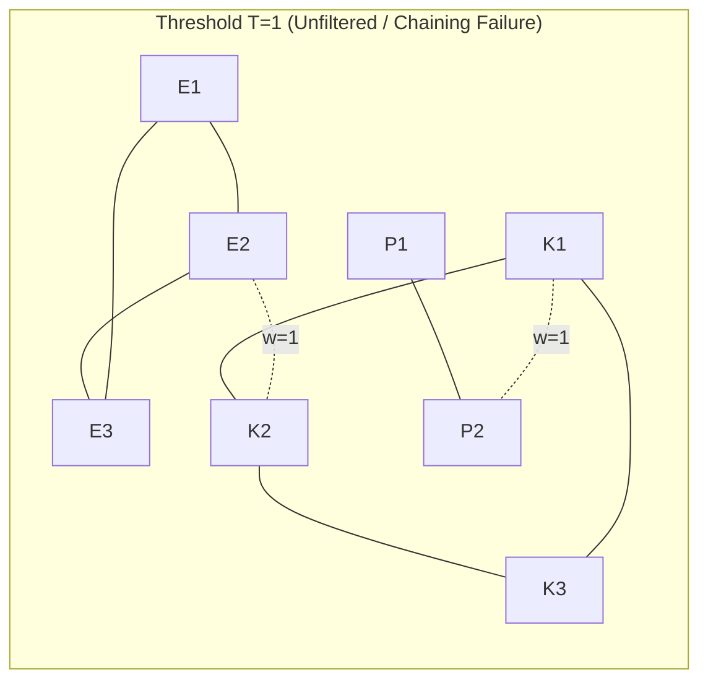
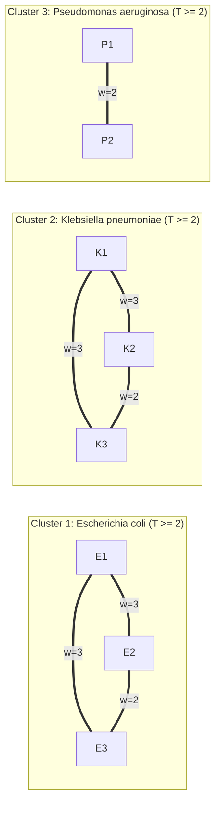

# LSH Banding Graph Theoretical Framework & Edge Generation

## 1. The Fundamental Question: Groups vs. Pairs to Clusters

When MinHash sketches are partitioned across $b$ bands, each band hashes genomes into discrete integer buckets. 
Each bucket that contains two or more genomes gives us an observed **group** of colliding genomes:
$$\text{Bucket } B = \{G_1, G_2, \dots, G_k\}$$

Across all $b$ bands, we observe a collection of overlapping groups. The central question of Part 3 is:

> **How do we synthesize these overlapping groups into discrete, biologically meaningful clusters?**

Specifically:
- **Do we need to generate pairwise edges at all?**
- **Can we go directly from Groups $\to$ Clusters?**
- **Under what conditions does Groups $\to$ Clusters equal Groups $\to$ Pairs $\to$ Clusters?**
- **What is the pure theoretical framework for setting the collision threshold $T$?**

---

## 2. Realistic 8-Genome, 3-Cluster Benchmark Example

To understand the mechanics without drowning in 3.09 million assemblies, we trace $N=8$ genomes across $b=4$ bands designed to resolve into **3 biologically distinct clusters**:
1. **Cluster 1 (*E. coli* Core)**: $E_1, E_2, E_3$ (near-identical enteric strains, ANI $> 99.5\%$)
2. **Cluster 2 (*K. pneumoniae* Core)**: $K_1, K_2, K_3$ (distinct species in Enterobacteriaceae, ANI $> 99.0\%$)
3. **Cluster 3 (*P. aeruginosa* Core)**: $P_1, P_2$ (distant non-enteric pseudomonad, ANI $> 99.2\%$)

### The Hash Band Assignment Matrix ($b=4$ Bands):

| Genome | Band 0 | Band 1 | Band 2 | Band 3 | Biological Identity |
| :--- | :---: | :---: | :---: | :---: | :--- |
| **$E_1$** | **101** | **201** | **301** | **401** | *E. coli* isolate 1 |
| **$E_2$** | **101** | **201** | **301** | *999* | *E. coli* isolate 2 (shares resistance plasmid *999* in Band 3) |
| **$E_3$** | **101** | **201** | 888 | **401** | *E. coli* isolate 3 |
| **$K_1$** | **501** | *601* | **701** | **801** | *K. pneumoniae* isolate 1 |
| **$K_2$** | **501** | *601* | **701** | *999* | *K. pneumoniae* isolate 2 (shares resistance plasmid *999* in Band 3) |
| **$K_3$** | **501** | *601* | 777 | **801** | *K. pneumoniae* isolate 3 |
| **$P_1$** | **901** | **902** | **903** | **904** | *P. aeruginosa* isolate 1 |
| **$P_2$** | **901** | *601* | **903** | 995 | *P. aeruginosa* isolate 2 (transient ribosomal k-mer *601* in Band 1) |

> [!NOTE]
> **Theoretical Link to Section 6.1 (Generative Model)**:
> In this matrix, true intra-species pairs have high Jaccard similarity ($J_1 \approx 0.80$), yielding expected collisions $\mathbb{E}[W] = 4 \times 0.80^2 \approx 2.56$ bands.
> The cross-species plasmid hit ($E_2, K_2$) and the ribosomal hit ($K_i, P_2$) represent low-Jaccard background noise ($J_0 \approx 0.25$), yielding $\mathbb{E}[W] = 4 \times 0.25^2 = 0.25$ bands (sporadic 1-band hits).

---

## 3. The Inverted Bucket Index (Observed Groups)

Group genomes by `(band_idx, bucket_id)`. Singletons are omitted:

```text
Band 0:
  Bucket 101 -> [E1, E2, E3]           (E. coli core collision)
  Bucket 501 -> [K1, K2, K3]           (Klebsiella core collision)
  Bucket 901 -> [P1, P2]               (Pseudomonas core collision)

Band 1:
  Bucket 201 -> [E1, E2, E3]           (E. coli core collision)
  Bucket 601 -> [K1, K2, K3, P2]       (Klebsiella core + transient Pseudomonas collision)

Band 2:
  Bucket 301 -> [E1, E2]               (E. coli pair)
  Bucket 701 -> [K1, K2]               (Klebsiella pair)
  Bucket 903 -> [P1, P2]               (Pseudomonas core collision)

Band 3:
  Bucket 401 -> [E1, E3]               (E. coli pair)
  Bucket 801 -> [K1, K3]               (Klebsiella pair)
  Bucket 999 -> [E2, K2]               (Cross-species plasmid collision)
```

Now let us execute both paradigms on these exact buckets.

---

## 4. Paradigm 1: Direct Groups $\to$ Clusters (Hypergraph DSU)

In this approach, we do not create pairs. Each bucket is unioned directly in a Disjoint-Set Union (DSU) structure:
For a bucket with members $[v_0, v_1, v_2, \dots]$, perform $\text{union}(v_0, v_i)$ for all $i \ge 1$.

### Step-by-Step Execution:
1. **Band 0**:
   - Bucket 101: $\text{union}(E_1, E_2), \text{union}(E_1, E_3) \implies \text{Set } \{E_1, E_2, E_3\}$
   - Bucket 501: $\text{union}(K_1, K_2), \text{union}(K_1, K_3) \implies \text{Set } \{K_1, K_2, K_3\}$
   - Bucket 901: $\text{union}(P_1, P_2) \implies \text{Set } \{P_1, P_2\}$
   - *State: 3 clean clusters.*

2. **Band 1**:
   - Bucket 201 (`[E1, E2, E3]`): Already in same set.
   - Bucket 601 (`[K1, K2, K3, P2]`):
     - $\text{union}(K_1, K_2)$ and $\text{union}(K_1, K_3)$ are already connected.
     - **$\text{union}(K_1, P_2)$ bridges Klebsiella and Pseudomonas!**
     - Transitive closure: $\{P_1, P_2\}$ merges into $\{K_1, K_2, K_3\}$!
     - *State: 2 clusters: $\{E_1, E_2, E_3\}$ and $\{K_1, K_2, K_3, P_1, P_2\}$.*

3. **Band 2**:
   - Reinforces internal connections within $\{E_1, E_2\}$, $\{K_1, K_2\}$, $\{P_1, P_2\}$. No new merges.

4. **Band 3**:
   - Bucket 401 and Bucket 801 reinforce internal sets.
   - **Bucket 999 (`[E2, K2]`):**
     - **$\text{union}(E_2, K_2)$ bridges E. coli and Klebsiella!**
     - Transitive closure: $\{E_1, E_2, E_3\}$ merges with the entire $\{K + P\}$ super-component!

### Final Result of Paradigm 1:
$$\mathbf{\{E_1, E_2, E_3, K_1, K_2, K_3, P_1, P_2\} \quad \text{(1 Mega-Cluster!)}}$$

> [!CAUTION]
> **Theoretical Link to Section 6.3 (Percolation Criterion)**:
> In this 8-genome system, setting $T=1$ creates 4 cross-species noise edges. The average cross-taxa degree becomes $\langle d_{\text{false}} \rangle = \frac{2 \times 4}{8} = 1.0 \ge 1.0$.
> This strictly triggers the **Erdős-Rényi phase transition**, causing the entire graph to percolate into a single connected giant component.

---

## 5. Paradigm 2: Groups $\to$ Pairs $\to$ Thresholded Graph $\to$ Clusters

In this approach, we decompose every bucket of size $k$ into its constituent pairs $\binom{k}{2}$, incrementing a collision weight counter $w(u, v)$.

### Pairwise Evidence Accumulation:
- **From Band 0**:
  - `(E1, E2)` +1, `(E1, E3)` +1, `(E2, E3)` +1
  - `(K1, K2)` +1, `(K1, K3)` +1, `(K2, K3)` +1
  - `(P1, P2)` +1
- **From Band 1**:
  - `(E1, E2)` +1, `(E1, E3)` +1, `(E2, E3)` +1
  - `(K1, K2)` +1, `(K1, K3)` +1, `(K2, K3)` +1
  - `(K1, P2)` +1, `(K2, P2)` +1, `(K3, P2)` +1  *(transient noise)*
- **From Band 2**:
  - `(E1, E2)` +1
  - `(K1, K2)` +1
  - `(P1, P2)` +1
- **From Band 3**:
  - `(E1, E3)` +1
  - `(K1, K3)` +1
  - `(E2, K2)` +1  *(plasmid noise)*

---

### The Complete Pairwise Weight Matrix ($w$):

| Pair | Shared Bands ($w$) | Relationship | Status at $T=1$ | Status at $T=2$ |
| :--- | :---: | :--- | :---: | :---: |
| **$(E_1, E_2)$** | **3** | Core *E. coli* | Retained | **Retained** |
| **$(E_1, E_3)$** | **3** | Core *E. coli* | Retained | **Retained** |
| **$(E_2, E_3)$** | **2** | Core *E. coli* | Retained | **Retained** |
| **$(K_1, K_2)$** | **3** | Core *K. pneumoniae* | Retained | **Retained** |
| **$(K_1, K_3)$** | **3** | Core *K. pneumoniae* | Retained | **Retained** |
| **$(K_2, K_3)$** | **2** | Core *K. pneumoniae* | Retained | **Retained** |
| **$(P_1, P_2)$** | **2** | Core *P. aeruginosa* | Retained | **Retained** |
| *(E_2, K_2)* | *1* | *Cross-species plasmid* | Retained *(bridges E & K)* | **PRUNED ($< 2$)** |
| *(K_1, P_2)* | *1* | *Conserved rRNA repeat* | Retained *(bridges K & P)* | **PRUNED ($< 2$)** |
| *(K_2, P_2)* | *1* | *Conserved rRNA repeat* | Retained *(bridges K & P)* | **PRUNED ($< 2$)** |
| *(K_3, P_2)* | *1* | *Conserved rRNA repeat* | Retained *(bridges K & P)* | **PRUNED ($< 2$)** |

---

### Resulting Graph Topologies:





### Final Connected Components at $T=2$:
1. **Cluster 1**: $\{E_1, E_2, E_3\}$ (*Escherichia coli*)
2. **Cluster 2**: $\{K_1, K_2, K_3\}$ (*Klebsiella pneumoniae*)
3. **Cluster 3**: $\{P_1, P_2\}$ (*Pseudomonas aeruginosa*)

> [!TIP]
> **Theoretical Link to Section 6.4 (Feasibility Window)**:
> In Section 6, the theoretical safe threshold for this 8-genome micro-system requires $\beta(T) < \frac{1}{8} = 0.125$.
> For $b=4, p_0=0.0625$, $\beta(1) = 22.7\% > 0.125$ (unsafe), whereas $\beta(2) = 2.0\% < 0.125$ (safe). Setting $T=2$ precisely satisfies the theoretical percolation bound.

---

## 6. Pure Theoretical Framework for Threshold $T$ Determination

This section formalizes the exact mathematical theory for choosing $T$ prior to empirical testing.

### 6.0 Formal Mathematical Definitions & Problem Formulations

Before analyzing the threshold derivation, we define the foundational mathematical problems and concepts that govern this system:

1. **The Locality-Sensitive Hashing (LSH) Collision Problem (Indyk & Motwani, 1998)**:
   - *Definition*: Given a metric space $(\mathcal{M}, d)$, a family of hash functions $\mathcal{H} = \{h: \mathcal{M} \to U\}$ is called $(r_1, r_2, p_1, p_2)$-sensitive if for any pair $u, v \in \mathcal{M}$:
     - If $d(u, v) \le r_1$, then $\Pr_{h \in \mathcal{H}}[h(u) = h(v)] \ge p_1$.
     - If $d(u, v) \ge r_2$, then $\Pr_{h \in \mathcal{H}}[h(u) = h(v)] \le p_2$.
   - *In MinHash*: The metric is the Jaccard distance $d_J(u, v) = 1 - J(u, v)$, with collision probability exactly equal to similarity: $\Pr[h(u) = h(v)] = J(u, v)$. Banding $r$ rows per band creates an amplified family with collision probability $p = J^r$.

2. **The Bernoulli Scheme & Binomial Tail Problem**:
   - *Definition*: Let $X_1, X_2, \dots, X_b$ be $b$ independent and identically distributed (i.i.d.) Bernoulli random variables, where each $X_j \in \{0, 1\}$ and $\Pr[X_j = 1] = p$. 
   - The total number of band collisions is the sum $W = \sum_{j=1}^b X_j$, governed by the Binomial distribution:
     $$\Pr[W = k] = \binom{b}{k} p^k (1 - p)^{b - k}$$
   - *The Tail Problem*: Evaluating the cumulative survival function $\Pr[W \ge T]$ for integer threshold $T \in \{0, \dots, b\}$, which quantifies the probability of exceeding the threshold under a given parameter $p$.

3. **The Neyman-Pearson Binary Hypothesis Testing Problem (Neyman & Pearson, 1933)**:
   - *Definition*: Given an observation $W \in \{0, \dots, b\}$, decide between two states of nature:
     - $H_0$ (Null Hypothesis: Noise / Unrelated): $J \le J_0 \implies p_0 = J_0^r$.
     - $H_1$ (Alternative Hypothesis: Homology / Same Species): $J \ge J_1 \implies p_1 = J_1^r$.
   - *Objective*: Find a decision rule $\delta(W) = \mathbf{1}[W \ge T]$ that maximizes statistical power $1 - \alpha(T)$ (minimizing False Negatives) subject to an upper bound on the significance level $\beta(T) \le \beta_{\max}$ (controlling False Positives).

4. **The Erdős-Rényi Percolation & Giant Component Problem (Erdős & Rényi, 1960)**:
   - *Definition*: In the random graph model $G(N, p_{\text{edge}})$, an undirected graph on $N$ vertices is formed where each of the $\binom{N}{2}$ potential edges is included independently with probability $p_{\text{edge}}$.
   - *The Phase Transition*: As $N \to \infty$, the structure of connected components undergoes an abrupt phase transition governed by the expected average vertex degree $\lambda = N \cdot p_{\text{edge}}$:
     - **Subcritical Regime ($\lambda < 1$)**: All connected components are small trees of order $\mathcal{O}(\log N)$. No component spans a macroscopic fraction of the graph.
     - **Critical Point ($\lambda = 1$)**: The largest component has size $\Theta(N^{2/3})$.
     - **Supercritical Regime ($\lambda > 1$)**: A unique **Giant Component** containing a strictly positive fraction $\Theta(N)$ of all vertices abruptly emerges, absorbing all other components.
   - *Significance for LSH*: If spurious cross-taxa edges have probability $p_{\text{edge}} = \beta(T) \ge \frac{1}{N}$, the background noise alone triggers this phase transition, collapsing unrelated species into an artificial global megacluster.

5. **The Regularized Incomplete Beta Function $I_x(a, b)$ Representation**:
   - *Definition*: The incomplete beta function is defined as $\text{B}(x; a, b) = \int_0^x t^{a-1}(1-t)^{b-1} dt$, and its regularized form is:
     $$I_x(a, b) = \frac{\text{B}(x; a, b)}{\text{B}(a, b)} = \frac{\int_0^x t^{a-1}(1-t)^{b-1} dt}{\int_0^1 t^{a-1}(1-t)^{b-1} dt}$$
   - *Identity*: By integration by parts, the discrete cumulative binomial tail is analytically identical to the regularized incomplete beta function:
     $$\sum_{k=T}^b \binom{b}{k} p^k (1 - p)^{b - k} = I_p(T, b - T + 1)$$
   - *Significance*: Eliminates numerical summation over hundreds of terms; enables exact analytical roots and continuous gradient evaluations for optimal $T$.

6. **The Transitive Chaining & Equivalence Closure Pathology**:
   - *Definition*: Let $R \subseteq V \times V$ be an undirected adjacency relation. The connected components of the graph are the equivalence classes of the **transitive closure** $R^+$:
     $$u \sim v \iff \exists \text{ path } (u = x_0, x_1, \dots, x_k = v) \text{ such that } (x_i, x_{i+1}) \in R$$
   - *The Pathology*: In single-linkage clustering ($T=1$), transitivity is unconditional: $u \sim v$ requires only a single bridge. A single false positive edge $(x_i, x_{i+1})$ between two dense, disjoint clusters $C_1$ and $C_2$ causes the equivalence relation to merge the entire sets: $C_1 \cup C_2$.

---

### 6.1 The Binomial Generative Model
Let two genomes $u, v$ have true MinHash Jaccard similarity $J \in [0, 1]$.
When partitioned into $b$ bands of length $r$:
1. The probability that all $r$ hashes match in any given band is:
   $$p(J) = J^r$$
2. Because each band is an independent hash partition, the total number of shared bands $W(u, v)$ follows a **Binomial Distribution**:
   $$W \sim \text{Binomial}(b, p(J))$$
   $$\mathbb{E}[W] = b \cdot J^r, \quad \text{Var}(W) = b \cdot J^r(1 - J^r)$$

### 6.2 The Dual-Hypothesis Decision Problem
We frame edge generation as a Neyman-Pearson statistical hypothesis test:
- **Null Hypothesis $H_0$ (Unrelated / Cross-Taxa Noise)**:
  $J \le J_0$ (e.g., $J_0 \le 0.15$ cross-genus noise, plasmid transfers, or rRNA repeats).
  $$p_0 = J_0^r$$
- **Alternative Hypothesis $H_1$ (Homologous / Core Species)**:
  $J \ge J_1$ (e.g., $J_1 \ge 0.50$ species core $\approx 94\%$ ANI, or $J_1 \ge 0.85$ strain core $\ge 99\%$ ANI).
  $$p_1 = J_1^r$$

An edge is accepted if and only if $W \ge T$. The two error rates are:
1. **False Negative Rate ($\alpha(T)$, Type I Error)**: Missing a true homologous edge:
   $$\alpha(T) = \Pr[W < T \mid J = J_1] = \sum_{w=0}^{T-1} \binom{b}{w} p_1^w (1 - p_1)^{b-w} = I_{1 - p_1}(b - T + 1, T)$$
2. **False Positive Rate ($\beta(T)$, Type II Error)**: Retaining a spurious noise edge:
   $$\beta(T) = \Pr[W \ge T \mid J = J_0] = \sum_{w=T}^{b} \binom{b}{w} p_0^w (1 - p_0)^{b-w} = I_{p_0}(T, b - T + 1)$$
*(where $I_x(a, b)$ is the regularized incomplete beta function).*

### 6.3 The Erdős-Rényi Percolation Lower Bound on $T$
In a dataset of $N$ assemblies, the number of candidate pairs is $\binom{N}{2} \approx \frac{N^2}{2}$.
The vast majority ($>99.99\%$) are unrelated pairs under $H_0$.

In random graph theory ($G(N, p)$), a **Giant Component** (percolation blob) forms if and only if the average degree contributed by random false edges exceeds $1$:
$$\langle d_{\text{false}} \rangle = N \cdot \beta(T) > 1$$

To **mathematically prevent runaway percolation chaining**, the false positive rate must strictly satisfy:
$$\beta(T) < \frac{1}{N}$$

This defines the **Exact Theoretical Lower Bound for $T$**:
$$T^*_{\text{safe}} = \min \left\{ T \in \{1, \dots, b\} \;\middle|\; \sum_{w=T}^{b} \binom{b}{w} (J_0^r)^w (1 - J_0^r)^{b-w} < \frac{1}{N} \right\}$$

### 6.4 The Homology Sensitivity Upper Bound on $T$
To ensure that true biological clusters do not shatter into isolated fragments, we require that the probability of retaining true edges exceeds a sensitivity threshold $1 - \epsilon$ (e.g., $99\%$ sensitivity $\implies \alpha(T) \le 0.01$):
$$T^*_{\text{sens}} = \max \left\{ T \in \{1, \dots, b\} \;\middle|\; \Pr[W < T \mid J = J_1] \le \epsilon \right\}$$

### 6.5 The Feasibility Window
A theoretically valid threshold $T$ exists if and only if:
$$T^*_{\text{safe}} \le T \le T^*_{\text{sens}}$$

#### Numerical Evaluation on AllTheBacteria ($N = 3.09 \times 10^6, b = 100$):
- Target Homology: $J_1 = 0.50$ (species core).
- Background Noise Ceiling: $J_0 = 0.15$ (cross-genus / plasmid noise).

| Band Length ($r$) | Noise Rate $p_0 = J_0^r$ | Signal Rate $p_1 = J_1^r$ | $T^*_{\text{safe}}$ ($\beta < 1/N$) | $T^*_{\text{sens}}$ ($\alpha \le 0.01$) | Valid Theoretical Window |
| :---: | :---: | :---: | :---: | :---: | :---: |
| **$r = 2$** | $0.0225$ | $0.2500$ | **$15$** | **$16$** | **$T \in [15, 16]$** *(tight window)* |
| **$r = 3$** | $0.0034$ | $0.1250$ | **$6$** | **$7$** | **$T \in [6, 7]$** |
| **$r = 4$** | $0.0005$ | $0.0625$ | **$3$** | **$4$** | **$T \in [3, 4]$** |

> [!IMPORTANT]
> **Key Theoretical Insight**:
> Increasing rows per band $r$ from $2 \to 3$ suppresses noise exponentially ($J_0^3 = 0.0034$ vs $J_0^2 = 0.0225$). 
> This lowers the required percolation-safe threshold from $T=15$ down to $T=6$, drastically reducing the pair-counting memory footprint!

---

## 7. The Equivalence Theorem & Practical Rules

> ### Theorem (Equivalence of Direct Groups and Pairs at $T=1$)
> Let $\mathcal{H} = (V, \mathcal{E})$ be the hypergraph where each hyperedge is a bucket $B$. 
> Let $G = (V, E)$ be the graph formed by clique expansion $E = \bigcup_{B} \binom{B}{2}$.
> 
> The connected components of hypergraph $\mathcal{H}$ (direct Group DSU) and the connected components of graph $G$ (Pairwise DSU at $T=1$) are **strictly identical**:
> $$\mathcal{CC}(\mathcal{H}) \equiv \mathcal{CC}(G)$$

### What This Teaches Us for Implementation:

1. **If $T = 1$ (Single Linkage)**:
   - Pairs are completely unnecessary. We can stream bucket groups directly into DSU clusters with zero edge allocations, $\mathcal{O}(N \cdot b)$ time, and $\mathcal{O}(N)$ memory.
   - *However*, as mathematically proven in Section 6.3 and demonstrated in Section 4, $T=1$ violates the percolation condition ($\beta(1) \gg 1/N$), causing catastrophic cross-genus megaclusters.

2. **If $T \ge T^*_{\text{safe}}$ (Multi-Band Thresholding)**:
   - **We MUST compute pairs and accumulate collision weights.**
   - A direct DSU cannot distinguish between a transient 1-band plasmid hit ($w=1$) and true whole-genome homology ($w=3$).
   - Pruning edges with $w < T$ is the exact mathematical operation that enforces $\beta(T) < 1/N$, suppressing false percolation and yielding clean biological clusters.

---

## 8. Strategic Architecture for Task 3 (`bucket_indexer.py`)

Adhering strictly to **mono-function, single-responsibility design**:

1. **Task 3 (`bucket_indexer.py`)**:
   - **Role**: **Evidence Accumulator & Pair Extractor**.
   - Input: Stream of `(accession, bucket_ids)` from Task 2.
   - Internal: Dictionary of bucket postings $\to$ pair expansion $\to$ collision counter.
   - Output: Filtered edge stream `(acc_A, acc_B, weight)` where `weight >= min_shared_bands` ($T$).
   
2. **Task 4 (`cluster_builder.py`)**:
   - **Role**: **Connected Components Solver**.
   - Input: Stream of filtered edges `(acc_A, acc_B, weight)` from Task 3.
   - Internal: Lightweight Disjoint-Set Union (DSU) with path compression.
   - Output: Partition of genomes into final cluster sets.

This separation guarantees that:
- You can inspect candidate pairwise edges and their exact empirical weights before clustering.
- You can tune $T$ across the theoretical feasibility window $[T^*_{\text{safe}}, T^*_{\text{sens}}]$ without modifying the ingestion or banding logic.

---

## 9. Cross-References & Master Links
- [[Mash LSH Band Clustering Master Tracking]] — Milestone 3 Implementation Roadmap.
- [[How to Put All the World's Genomes on a Laptop — Sketching, Clustering, Ordering, Cutting, and Multithreading]] — Graph Cutpoints and Skeleton Trees.
