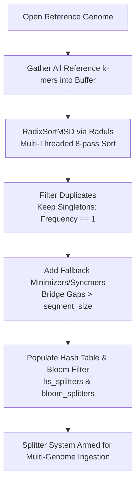
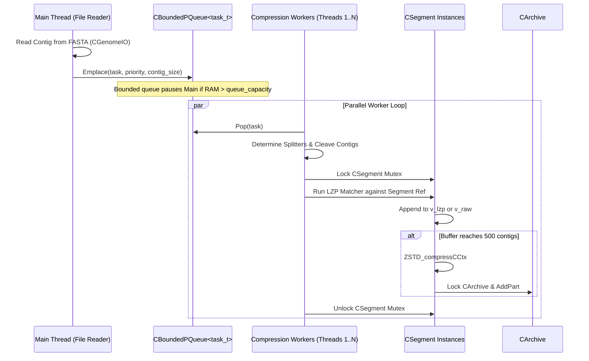

# AGC (Assembled Genomes Compressor) In-Depth Architectural Guide

## 1. Executive Summary & System Philosophy

**AGC** (*Assembled Genomes Compressor*) is an ultra-high-performance, loss-free, reference-guided compressor designed by Sebastian Deorowicz, Agnieszka Danek, and Heng Li for massive pan-genomic collections and assembled genomes (bacterial, viral, fungal, plant, and animal datasets).

```
================================================================================
                         AGC ARCHITECTURAL TOPOLOGY
================================================================================

 [ FASTA Input Genomes ]
            |
            v
 [ CGenomeIO (libdeflate) ] ----> 2-bit Encoded Contigs (A=0, C=1, G=2, T=3)
            |
            v
 [ Splitter Discovery ] --------> Canonical k-mers + RadixSort (Raduls) + Fallback Minimizers
            |
            v
 [ Segmentation Engine ] -------> (Left Splitter, Right Splitter) ==> Segment ID
            |
            v
 [ Bounded Task Queue ] --------> CBoundedPQueue<task_t> (Multi-Producer / Consumer)
            |
            +------------------------------+-------------------------------+
            |                              |                               |
     [ Worker Thread 0 ]            [ Worker Thread 1 ]             [ Worker Thread N-1 ]
            |                              |                               |
     LZ-Diff Matcher                LZ-Diff Matcher                 LZ-Diff Matcher
     (against Ref Seq)              (against Ref Seq)               (against Ref Seq)
            |                              |                               |
            v                              v                               v
 [ Active CSegment Buffers ] ---> v_lzp (Matched Deltas) & v_raw (Literals)
            |
            v (When vector reaches contigs_in_pack = 500)
 [ Zstandard Engine ] ----------> ZSTD Block Compression (Level 10)
            |
            v
 [ CArchive Container ] --------> Multi-Stream Physical Output Chunks + Global Index
```

### The Pan-Genome Compression Dilemma
Massive genomic datasets (e.g. 10,000 *E. coli* or *Pseudomonas* genomes) contain massive redundancy (>95% sequence identity). However:
1. **General-purpose compressors** (`gzip`, `zstd`, `xz`, `bzip2`) use fixed sliding dictionary windows (32 KB in gzip, up to 128 MB in ZSTD). Once dataset size exceeds the window size, the compressor "forgets" earlier sequences, missing cross-genome redundancy entirely.
2. **Whole-genome multiple alignment tools** require quadratic or high-polynomial compute time and memory, failing completely beyond a few dozen genomes.
3. **Existing specialized tools** compress well but store data as monolithic archives requiring full, sequential decompression to query a single contig.

### AGC's Four Core Design Pillars
1. **Segment-Based Redundancy Localization**: Incoming contigs are cleaved at predictable sequence markers called **splitters** ($k$-mers) and routed to deterministic segment groups. Genomes that share biology automatically share segment buckets regardless of file ordering.
2. **LZ-Prediction Delta Compression**: Within each segment, sequences are delta-encoded against a reference sequence using a fast, sparse hash-table Lempel-Ziv predictor (`CLZDiff`).
3. **Sub-Second Random Access Queries**: Contigs are addressable independently. Querying a 5,000 bp contig from a 500 GB archive requires seeking and decompressing only a few small ZSTD chunks (<100 KB total), executing in milliseconds.
4. **Incremental Appending**: New genomes can be appended to existing archives (`agc append`) without full recompression.

---

## 2. Low-Level Sequence Representation & Ingestion

### Nucleotide Alphabet & 2-Bit Encoding
Biological DNA consists of four primary nucleotides: Adenine ($A$), Cytosine ($C$), Guanine ($G$), and Thymine ($T$), plus ambiguous bases ($N$).
AGC maps nucleotides into compact 8-bit unsigned integers (`uint8_t`):

| Nucleotide | AGC Numeric Code | Binary | Description |
| :--- | :--- | :--- | :--- |
| **A** | `0` | `00` | Standard base |
| **C** | `1` | `01` | Standard base |
| **G** | `2` | `10` | Standard base |
| **T** | `3` | `11` | Standard base |
| **N** | `4` | `100` | Ambiguous base / unknown |
| **Contig Delimiter** | `0xff` (`255`) | `11111111` | Out-of-band boundary delimiter |
| **N-Run Starter** | `30` | `00011110` | Run-length encoded $N$-string starter |
| **Invalid** | `31` | `00011111` | End-of-stream sentinel |

Inside [`src/common/defs.h`](file:///Users/ktruong/tools/agc-split-size/src/common/defs.h):
```cpp
typedef vector<uint8_t> contig_t;
typedef vector<uint8_t> packed_block_t;
```

### Tuple/Nibble Compression Pre-Processing
Before passing raw contig vectors to Zstandard, AGC further packs standard 2-bit bases into dense tuples (`bytes2tuples` / `tuples2bytes` in [`src/common/segment.h`](file:///Users/ktruong/tools/agc-split-size/src/common/segment.h)):
- When sequence contains only standard bases ($< 4$), four bases are packed into a single byte (`4 bases / 1 byte`).
- When symbols reach up to 5, three symbols are packed into a byte.
- This preliminary compaction shrinks memory buffers and increases ZSTD entropy density before final block encoding.

### Fast Streaming I/O (`CGenomeIO`)
Located in [`src/core/genome_io.h`](file:///Users/ktruong/tools/agc-split-size/src/core/genome_io.h) and [`src/core/genome_io.cpp`](file:///Users/ktruong/tools/agc-split-size/src/core/genome_io.cpp):
- Integrated with `libdeflate` for gzip streaming.
- Reads files line-by-line or chunk-by-chunk using custom buffering (`io_buffer_size = 8 MB`).
- Automatically strips common suffixes (`.fa`, `.fasta`, `.fna`, `.gz`) to derive internal sample IDs.

---

## 3. Algorithmic Foundation: Splitters & Segmentation

### Why Splitters?
Genomic contigs range from hundreds of bases to hundreds of megabases (e.g. human chromosome 1 $\approx 248\text{ Mbp}$). To compress assemblies in parallel with random access, sequences must be cut into manageable chunks.
If sequences were cut arbitrarily (e.g. every 50,000 bp), small insertions or deletions (indels) would shift all downstream split boundaries, destroying sequence alignment across samples.

**The Splitter Solution**: Split at specific sequence patterns ($k$-mers) that occur naturally across genomes.
- If Genome A and Genome B share a unique $k$-mer sequence, both genomes will be cleaved at that exact position, creating locally synchronized segment boundaries despite large upstream or downstream indels.

```
Genome A:  ...[ACTTGCAAT]...[Splitter K1]...[Sequence Chunk X]...[Splitter K2]...
Genome B:  ......[AAT]......[Splitter K1]...[Sequence Chunk X]...[Splitter K2]...
                                 |                                    |
                                 +---------- SEGMENT (K1, K2) --------+
```

### The Splitter Discovery Pipeline



1. **Canonical $k$-mers (`CKmer`)**:
   Located in [`src/core/kmer.h`](file:///Users/ktruong/tools/agc-split-size/src/core/kmer.h). A canonical $k$-mer is defined as:
   $$\text{canonical}(k\text{-mer}) = \min\left(k\text{-mer}, \text{reverse\_complement}(k\text{-mer})\right)$$
   This ensures orientation-invariant matching regardless of whether a contig was assembled in the forward or reverse orientation.
2. **Parallel K-mer Collection**:
   `CAGCCompressor::count_kmers` spawns $T$ threads populating `v_candidate_kmers`.
3. **Radix Sorting via Raduls**:
   Uses the ultra-fast `raduls::RadixSortMSD` library to sort hundreds of millions of 64-bit $k$-mer keys in parallel across 8 memory passes.
4. **Singleton Filtering**:
   `remove_non_singletons()` discards duplicated $k$-mers. Only $k$-mers that appear **exactly once** in the reference genome are retained as candidate splitters. This guarantees that a splitter uniquely identifies a single genomic locus.
5. **Fallback Minimizers**:
   If a reference region contains low complexity or repetitive sequences, the distance between successive singleton splitters might exceed `segment_size` (default: 60,000 bp). AGC inserts fallback minimizers (`add_fallback_kmers`, parameterized by `fallback_frac = 0.05`) to prevent excessively long segments.
6. **Bloom Filter Acceleration**:
   `bloom_splitters` provides $O(1)$ negative testing for incoming worker threads, avoiding hash table lookups for $k$-mers that cannot be splitters.

---

## 4. Dual-Mode Sequence Encoding: LZ-Prediction (`CLZDiff`)

Once a contig is segmented between `(left_splitter, right_splitter)`, it is dispatched to the corresponding `CSegment`.
Inside the segment, sequences are compressed against the segment's **Reference Sequence** using **Lempel-Ziv Prediction (LZP)**.

### Sparse Hash Table Reference Indexing
Located in [`src/common/lz_diff.h`](file:///Users/ktruong/tools/agc-split-size/src/common/lz_diff.h) and [`src/common/lz_diff.cpp`](file:///Users/ktruong/tools/agc-split-size/src/common/lz_diff.cpp):
- The reference sequence of the segment is indexed into a hash table (`ht16` or `ht32` depending on segment length).
- AGC uses a **sparse hash table** (`USE_SPARSE_HT`, `hashing_step = 4`). Only every 4th position of the reference is indexed, cutting hash table memory consumption by 75% with negligible match degradation.
- Load factor is capped at 0.7 (`max_load_factor = 0.7`) with linear probing capped at 64 steps (`max_no_tries = 64`).

### Matching & Delta Generation
When a new sequence arrives in `CSegment`:
1. The LZP matcher slides along the incoming sequence and queries the sparse reference index.
2. If a match of length $\ge \text{min\_match\_len}$ (default: 20 bp) is found:
   - It emits a **match tuple**: `(match_offset_in_reference, match_length)`.
   - It extends the match forward as far as possible using fast 64-bit word comparisons (`*(uint64_t*)ptr1 == *(uint64_t*)ptr2`).
3. If no match is found or symbols differ:
   - It emits **literal bytes** representing single-nucleotide polymorphisms (SNPs) or novel insertions.
4. If an uncompressed run of ambiguous bases ($N$) is encountered:
   - It emits an $N$-run starter (`N_run_starter_code = 30`) followed by run-length encoding.

### The Two Segment Queues: `v_lzp` vs `v_raw`
Inside `CSegment`:
- **`v_lzp`**: Stores contigs that had sufficient sequence similarity to the reference. Sequences are stored as compact delta commands.
- **`v_raw`**: If a sequence shares the splitters but contains completely divergent intervening DNA (poor match ratio), it is stored in `v_raw` as raw sequence to avoid bloating the delta stream with low-efficiency LZP markers.

---

## 5. Batching, Compression Packs, & ZSTD Architecture

### Cardinality-Based Batching (`contigs_in_pack`)
Zstandard (like any LZ77/Huffman/FSE compressor) requires hundreds of kilobytes of contiguous input data to build statistical frequency tables and sliding window dictionaries. Compressing single contigs independently yields poor compression ratios (~2:1).

To achieve state-of-the-art ratios (~30:1 to 50:1):
1. Inside each `CSegment`, incoming contigs accumulate in `v_lzp` and `v_raw`.
2. Contigs remain in memory until the vector reaches **`contigs_in_pack`** (default: `500` contigs).
3. Once 500 contigs accumulate:
   - The 500 contigs are packed into a single contiguous memory block delimited by `0xff`.
   - The block is compressed with `ZSTD_compressCCtx` at **compression level 10**.
   - The resulting compressed block is forwarded to `CArchive`.
   - `v_lzp` (or `v_raw`) resets to empty.

```
 CSegment Memory Accumulator
 [ Contig 1 ] [0xff] [ Contig 2 ] [0xff] ... [ Contig 500 ]
  \______________________________________________________/
                             |
             ZSTD_compressCCtx (Level 10)
                             |
                             v
           [ Compressed Part Chunk in CArchive ]
```

---

## 6. Storage Container Architecture: `CArchive`

AGC does not write raw ZSTD streams directly to disk. Instead, it embeds them into an indexed, chunk-based container managed by **`CArchive`** ([`src/common/archive.h`](file:///Users/ktruong/tools/agc-split-size/src/common/archive.h) / [`src/common/archive.cpp`](file:///Users/ktruong/tools/agc-split-size/src/common/archive.cpp)).

### Logical Stream Multiplexing
An AGC archive contains dozens of concurrent logical streams:

| Stream Name | Role | Payload Contents |
| :--- | :--- | :--- |
| `params` | Global Archive Config | $k$-mer length, `min_match_len`, `pack_cardinality`, `segment_size` |
| `splitters` | Splitter Registry | Sorted 64-bit canonical $k$-mer integers |
| `collection-desc` | High-Level Index | Archive version, sample list, contig counts |
| `collection-main` | Sample Index (V2/V3) | Sample names, sequence boundaries, checksums |
| `collection-details` | Segment Mapping | Maps each contig to its segment IDs and offsets |
| `cmdline` | Provenance | Exact CLI command string that created the archive |
| `ref-0`, `ref-1`, ... | Segment References | Raw uncompressed or packed reference sequence for segment $i$ |
| `delta-0`, `delta-1`, ... | Segment Deltas | Sequentially compressed 500-contig ZSTD blocks for segment $i$ |

### Chunk Indexing (`part_t`)
Each logical stream is composed of a series of discrete parts (`part_t`):
```cpp
struct part_t {
    size_t offset;  // Absolute byte offset within the physical file
    size_t size;    // Exact compressed byte length of this chunk on disk
};
```
When `CArchive::AddPart` is invoked:
- It appends the compressed chunk to the physical file descriptor (`f_out`).
- It records the chunk's `{ offset, size }` in `v_streams[stream_id].parts`.
- It updates `f_offset += size`.

### Serialization & Footer Layout
When `Close()` is called on `CArchive`:
1. All pending output buffers are flushed to disk (`flush_out_buffers()`).
2. `CArchive::serialize()` writes the master stream directory at the end of the file:
   - For every registered stream: stream name, part count, and the table of all `part_t` `{ offset, size }` records.
   - At the absolute end of the file, it writes the directory byte offset and the magic footer signature (`AGC_FILE_MAJOR`, `AGC_FILE_MINOR`).
3. Because the directory is at the end, reading an archive only requires seeking to the end, reading the directory table, and lazily seeking to requested chunks on demand.

---

## 7. Multi-Threaded Concurrency Architecture

AGC achieves massive multi-core scaling (scaling cleanly across 64+ CPU cores) through an asynchronous, lock-free work distribution model:



### The Priority Queue: `CBoundedPQueue`
Located in [`src/common/queue.h`](file:///Users/ktruong/tools/agc-split-size/src/common/queue.h):
- **Bounded Capacity**: `queue_capacity = max(2ull << 30, no_threads * (192ull << 20))`. This prevents the file reader from caching hundreds of gigabytes of raw FASTAs in RAM if workers are slower than the disk.
- **Priority-Ordered**: Contigs from the same sample have matched priorities to ensure that a sample's contigs are processed together, minimizing intermediate memory footprints.

### Granular Locking
- **No Global Contention**: There is no global lock during sequence compression.
- Each segment has its own independent `std::mutex mtx`.
- With ~9,000 active segments and 16–32 worker threads, the probability of two threads contending for the same segment mutex at the same instant is $< 0.5\%$.

---

## 8. Random-Access Queries & Extraction Architecture

One of AGC's most celebrated features is the ability to extract individual contigs or sub-ranges in milliseconds without decompressing the whole archive (`agc getctg`).

### The Query Path: Step-by-Step
When a user runs:
```bash
agc getctg archive.agc Sample42:Contig99:1000-5000
```
1. **Directory Lookup**:
   AGC opens `archive.agc`, reads the terminal footer, and deserializes `CCollection_V3`.
2. **Coordinate Translation**:
   `CCollection_V3` locates `Sample42:Contig99` in its hash table:
   - Identifies the segment ID `seg_id` that contains this contig.
   - Identifies the pack batch index `pack_id` within that segment.
   - Identifies the contig's internal index within the batch.
3. **Targeted Chunk Fetching**:
   `CArchive` looks up `ref-seg_id` and `delta-seg_id` in `v_streams`:
   - Seeks directly to the byte offset of part `pack_id` in the physical file.
   - Reads **only that specific compressed chunk** (typically 20 KB to 100 KB).
4. **Zstandard Decompression**:
   Decompresses the single pack block in memory using `ZSTD_decompressDCtx`.
5. **Inverse LZP Reconstruction**:
   `CLZDecompress` decodes the delta commands against the segment's reference sequence, reconstructing the exact original contig.
6. **Slice & Output**:
   Slices substring `[1000, 5000]` and streams it directly to standard output.
   Total execution time: **$< 15\text{ milliseconds}$**!

---

## 9. How Split-Create (`-p`) Integrates with AGC

Now that AGC's full architecture is clear, the genius and challenge of the **`split-create`** modification becomes evident:

```
+------------------------------------------------------------------------------------+
|                         CApplication::create_split Loop                            |
|                                                                                    |
|  For each part:                                                                    |
|    1. Assign First Genome as Part Reference                                        |
|    2. Discover Local Splitters (RadixSort / Fallback)                              |
|    3. Initialize Clean CAGCCompressor & CArchive                                   |
|    4. Ingest Genomes via AddSampleSplit:                                           |
|                                                                                    |
|       [ Samples Ingestion ]                                                        |
|                 |                                                                  |
|                 v (Every 25 genomes)                                               |
|       [ Periodic Synchronization Barrier: Drain pq_contigs_desc ]                  |
|                 |                                                                  |
|                 v                                                                  |
|       [ Check Threshold: Naive Disk + Buffer Offset >= 75% ]                       |
|                 |                                                                  |
|                 +-- YES --> [ Worker Queue Drain ]                                 |
|                                     |                                              |
|                                     v                                              |
|                             [ GetSimulatedArchiveSize ]                            |
|                             (Parallel ZSTD Shadow Trial on RAM buffers)            |
|                                     |                                              |
|                                     v                                              |
|                             [ True Size = Disk Offset + Shadow RAM ]               |
|                                     |                                              |
|                                     +-- True Size >= 95% --> STOP & FINALIZE PART  |
|                                     |                                              |
|                                     +-- True Size < 95%  --> ADAPT CHECK INTERVAL  |
|                                                                                    |
|    5. Close Archive (Serializes Final Metadata Chunks & Footer)                    |
|    6. Advance Genome Cursor by Consumed Count & Increment Part ID                  |
+------------------------------------------------------------------------------------+
```

### 1. The Core Tension: Streaming vs. Batching
Because AGC buffers up to 500 contigs in each of its ~9,000 `CSegment` instances before writing anything to disk, querying `CArchive::GetCurrentOffset()` misses between 50% and 75% of the data in flight.

### 2. Why Shadow Simulation is the Only Correct Solution
- **Forced flushing** breaks segment continuity, ruins ZSTD dictionary history, introduces I/O stalls, and corrupts segment index maps.
- **`CSegment::simulate_store`** runs trial compressions on transient scratch buffers in RAM. It leaves segment contig vectors untouched, writes 0 bytes to disk, and leaves internal indices 100% pristine.

### 3. Adaptive Ingestion Control
- **Passive Stage (0% to 75%)**: Zero shadow trial overhead.
- **Strict Stage (75% to 95%)**: Dynamically samples simulated size.
- **The Half-Runway Rule**: Projects remaining genome capacity based on actual measured byte cost per genome, halving the check interval as the archive approaches the 95% stop threshold.
- **5% Metadata Buffer**: Absorbs `CCollection_V3`, `splitters`, and `CArchive` directory footer committed during `Close()`.

---

## 10. Codebase File Map & Technical Reference

| Path | Primary Class / Component | Architectural Role |
| :--- | :--- | :--- |
| [`src/app/main.cpp`](file:///Users/ktruong/tools/agc-split-size/src/app/main.cpp) | `CApplication::create_split`, `Run` | Master driver loop; coordinates multi-part partition workflows and subcommand routing. |
| [`src/app/application.h`](file:///Users/ktruong/tools/agc-split-size/src/app/application.h) | `CParams`, `CApplication` | Command-line option state; parses `-p`, `-x`, and zero-padded partition filenames. |
| [`src/app/application.cpp`](file:///Users/ktruong/tools/agc-split-size/src/app/application.cpp) | `parse_size_with_suffix`, `make_part_archive_name` | Overflow-safe integer parsing and zero-padded path generation. |
| [`src/core/agc_compressor.h`](file:///Users/ktruong/tools/agc-split-size/src/core/agc_compressor.h) | `CAGCCompressor` | Master compression controller; orchestrates workers, splitters, and archive streams. |
| [`src/core/agc_compressor.cpp`](file:///Users/ktruong/tools/agc-split-size/src/core/agc_compressor.cpp) | `AddSampleSplit`, `GetSimulatedArchiveSize` | Adaptive ingestion control, queue draining, and multi-threaded shadow sizing. |
| [`src/common/segment.h`](file:///Users/ktruong/tools/agc-split-size/src/common/segment.h) | `CSegment` | Segment state manager; holds `v_lzp`, `v_raw`, and segment reference sequence. |
| [`src/common/segment.cpp`](file:///Users/ktruong/tools/agc-split-size/src/common/segment.cpp) | `simulate_store`, `estimate_partial_compressed_size` | Non-destructive ZSTD shadow trial compression in transient memory. |
| [`src/common/archive.h`](file:///Users/ktruong/tools/agc-split-size/src/common/archive.h) | `CArchive` | Container format manager; multi-stream multiplexing and chunk index tracking. |
| [`src/common/archive.cpp`](file:///Users/ktruong/tools/agc-split-size/src/common/archive.cpp) | `GetCurrentOffset`, `serialize`, `deserialize` | Thread-safe committed disk offset querying and master footer serialization. |
| [`src/common/lz_diff.h`](file:///Users/ktruong/tools/agc-split-size/src/common/lz_diff.h) | `CLZDiffBase`, `CLZDiff`, `CLZDecompress` | Sparse hash-table LZ-prediction delta compression and decompression engine. |
| [`src/core/kmer.h`](file:///Users/ktruong/tools/agc-split-size/src/core/kmer.h) | `CKmer` | Canonical 2-bit $k$-mer sliding window and rolling hash calculator. |
| [`src/common/queue.h`](file:///Users/ktruong/tools/agc-split-size/src/common/queue.h) | `CBoundedPQueue`, `CBoundedQueue` | Multi-threaded priority queues with memory bounding and thread barrier primitives. |
| [`src/common/collection_v3.h`](file:///Users/ktruong/tools/agc-split-size/src/common/collection_v3.h) | `CCollection_V3` | High-performance sample-to-contig index registry supporting incremental batch serialization. |
| [`src/core/genome_io.h`](file:///Users/ktruong/tools/agc-split-size/src/core/genome_io.h) | `CGenomeIO` | High-speed FASTA/FASTQ reader interfacing with `libdeflate` for gzip streaming. |
