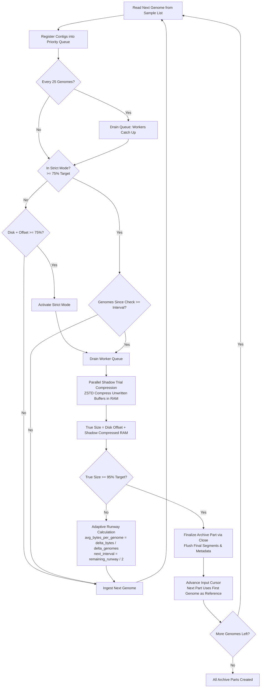

# AGC Partitioned Archive Mode (`-p <size>`) Engineering Roadmap

## Overview

This roadmap defines the architectural design, sprint breakdown, conceptual study guides, and mastery checkpoints for the **partitioned archive mode (`split-create`)** in AGC (Assembled Genomes Compressor).

Even though this mode is already implemented in `agc-split-size`, this roadmap is designed as a **step-by-step masterclass** so that you can thoroughly understand, re-derive, and learn the architectural patterns, concurrency mechanisms, and C++ techniques underpinning the solution.

> [!TIP]
> **Comprehensive Architectural Reference**: For an exhaustive, ground-up technical breakdown of AGC's internal mechanics—including 2-bit contig encoding, canonical $k$-mer splitter determination, sparse hash table LZP differential encoding, multi-stream `CArchive` serialization, and sub-second random query resolution—read [**`AGC_ARCHITECTURE_DEEP_DIVE.md`**](file:///Users/ktruong/tools/agc-split-size/modification_roadmap/AGC_ARCHITECTURE_DEEP_DIVE.md).

---

### The Problem
When archiving massive collections of pan-genomes or thousands of bacterial/viral isolates, users frequently need output archives bounded by a target file size (e.g., 500 MB or 2 GB per archive) for:
- Cloud object storage limits (S3 multi-part, egress limits)
- Parallel query and indexing over independent archive chunks
- Network distribution and resilient cluster synchronization

### Why Sizing in AGC is Hard: The Hidden Memory Tail
In standard AGC, the file write pointer (`CArchive::GetCurrentOffset()`) tracks only compressed blocks committed to disk. However, AGC uses an **asynchronous batching architecture**:
1. Incoming contigs are split and routed across thousands of concurrent segment instances (`CSegment`).
2. Inside each `CSegment`, sequences accumulate in raw, uncompressed memory vectors (`v_lzp` and `v_raw`).
3. A segment only flushes its batch to disk via ZSTD compression once it reaches `contigs_in_pack` contigs (typically 500).
4. As a result, at any point in time, thousands of active segments hold between 1 and 499 uncompressed contigs in RAM.
5. If size estimation relies solely on committed disk offset, the true final archive size is **underestimated by a factor of 2x to 3x**, causing massive size overshoots when `Close()` flushes all buffers at the end.

### The Solution: Non-Destructive In-Memory Shadow Trial Compression
Instead of destructive flushing (which breaks segment continuity and destroys ZSTD dictionary ratios), AGC uses a **two-stage adaptive shadow trial compression engine**:
- **Coarse Phase (0% to 75% of target size)**: Passive monitoring combining physical file offset and estimated buffer offset with zero synchronization stalls.
- **Strict Phase (75% to 95% of target size)**: Workers pause ingestion and run parallel in-memory ZSTD trial compressions on unwritten segment buffers (`simulate_store`) using temporary thread-local contexts.
- **Dynamic Adaptive Interval**: Calculates actual compressed bytes added per genome and schedules subsequent checks halfway to the target limit.
- **95% Stop Threshold**: Stops sample ingestion cleanly at 95% of `target_part_size`, reserving a 5% margin for global metadata (splitters, collection descriptors, file directory footer) serialized during `Close()`.

---

## Architectural Flowchart

---

## Sprint Modules & Mastery Checkpoints

| Sprint | Engineering Blueprint | Learning Guide | Mastery Exam & Challenge | Core Code Location |
| :--- | :--- | :--- | :--- | :--- |
| **Sprint 0: Test Harness & Toolchain** | [SPRINT_BRIEF.md](sprint_0_test_harness/SPRINT_BRIEF.md) | [study_guide.md](sprint_0_test_harness/study_guide.md) | [EXAM.md](sprint_0_test_harness/EXAM.md) | `makefile`, `refresh.mk` |
| **Sprint 1: Size Parser & CLI Plumbing** | [SPRINT_BRIEF.md](sprint_1_size_parser/SPRINT_BRIEF.md) | [study_guide.md](sprint_1_size_parser/study_guide.md) | [EXAM.md](sprint_1_size_parser/EXAM.md) | [`src/app/application.cpp`](file:///Users/ktruong/tools/agc-split-size/src/app/application.cpp#L681-L766) |
| **Sprint 2: Physical Offset & Memory Tail** | [SPRINT_BRIEF.md](sprint_2_archive_offset_and_memory_tail/SPRINT_BRIEF.md) | [study_guide.md](sprint_2_archive_offset_and_memory_tail/study_guide.md) | [EXAM.md](sprint_2_archive_offset_and_memory_tail/EXAM.md) | [`src/common/archive.cpp`](file:///Users/ktruong/tools/agc-split-size/src/common/archive.cpp#L361-L373) |
| **Sprint 3: Shadow Trial Compression** | [SPRINT_BRIEF.md](sprint_3_shadow_trial_compression/SPRINT_BRIEF.md) | [study_guide.md](sprint_3_shadow_trial_compression/study_guide.md) | [EXAM.md](sprint_3_shadow_trial_compression/EXAM.md) | [`src/common/segment.cpp`](file:///Users/ktruong/tools/agc-split-size/src/common/segment.cpp#L579-L623) |
| **Sprint 4: Multi-Threaded Size Estimator** | [SPRINT_BRIEF.md](sprint_4_multithreaded_size_estimator/SPRINT_BRIEF.md) | [study_guide.md](sprint_4_multithreaded_size_estimator/study_guide.md) | [EXAM.md](sprint_4_multithreaded_size_estimator/EXAM.md) | [`src/core/agc_compressor.cpp`](file:///Users/ktruong/tools/agc-split-size/src/core/agc_compressor.cpp#L2414-L2447) |
| **Sprint 5: Adaptive Split Ingestion** | [SPRINT_BRIEF.md](sprint_5_adaptive_split_ingestion/SPRINT_BRIEF.md) | [study_guide.md](sprint_5_adaptive_split_ingestion/study_guide.md) | [EXAM.md](sprint_5_adaptive_split_ingestion/EXAM.md) | [`src/core/agc_compressor.cpp`](file:///Users/ktruong/tools/agc-split-size/src/core/agc_compressor.cpp#L2449-L2707) |
| **Sprint 6: Partition Loop & Validation** | [SPRINT_BRIEF.md](sprint_6_partition_loop_and_validation/SPRINT_BRIEF.md) | [study_guide.md](sprint_6_partition_loop_and_validation/study_guide.md) | [EXAM.md](sprint_6_partition_loop_and_validation/EXAM.md) | [`src/app/main.cpp`](file:///Users/ktruong/tools/agc-split-size/src/app/main.cpp#L130-L212) |

---

## Detailed Sprint Summaries

### Sprint 0: Test Harness Setup & C++20 Toolchain Fundamentals
- **Objective**: Establish an isolated unit test target in the AGC GNU Make system using `doctest.h` without altering production build rules.
- **Concepts**: C++20 standards compliance (`-std=c++2a`), macOS Apple Silicon compilation flags (`-D_Static_assert=static_assert`, `PLATFORM=m1`), single-header testing frameworks.
- **Deliverables**: Standalone test runner capable of testing utility functions, string parsers, and data structures.

### Sprint 1: Size String Parser & Parameter Plumbing (`-p <size>` and `-x`)
- **Objective**: Enable AGC CLI to accept human-readable size strings (`-p 500M`, `-p 2G`) and strict mode flag (`-x`), and generate zero-padded output names (`sample.part001.agc`).
- **Concepts**: Safe integer arithmetic, preventing unsigned 64-bit overflow (`numeric_limits<uint64_t>::max()`), `std::filesystem::path` manipulation, zero-padded formatting with `std::ostringstream`, `std::setw`, `std::setfill`.
- **Deliverables**: `CApplication::parse_size_with_suffix`, `CApplication::make_part_archive_name`, and CLI wiring in `application.cpp`.

### Sprint 2: Physical Archive Offset Tracking & The Memory Tail Problem
- **Objective**: Implement thread-safe querying of bytes committed to disk in `CArchive` and empirically demonstrate why committed disk bytes drastically underestimate total archive size.
- **Concepts**: Mutex-protected file offset access (`std::lock_guard`), stream buffer flushing, asynchronous batching architectures, and why `contigs_in_pack` hides uncompressed data in RAM.
- **Deliverables**: `CArchive::GetCurrentOffset()` and `CAGCCompressor::GetCurrentArchiveSizeEstimate()`.

### Sprint 3: Non-Destructive In-Memory Shadow Trial Compression
- **Objective**: Build an in-memory trial compression routine inside `CSegment` that measures the exact compressed size of unwritten contigs without modifying segment state or writing to disk.
- **Concepts**: Zstandard C API (`ZSTD_createCCtx`, `ZSTD_compressCCtx`, `ZSTD_compressBound`), contiguous buffer packing with delimiters (`0xff`), exception safety, avoiding disk I/O, preserving compression dictionary integrity.
- **Deliverables**: `CSegment::simulate_store` and `CSegment::estimate_partial_compressed_size`.

### Sprint 4: Multi-Threaded Shadow Size Estimator
- **Objective**: Rapidly estimate total shadow compressed size across thousands of segments using a dedicated thread pool with zero lock contention.
- **Concepts**: Thread-local compression contexts, atomic task dispatching with `std::atomic<uint32_t>::fetch_add`, parallel reduction into `std::atomic<uint64_t>`, clean resource cleanup.
- **Deliverables**: `CAGCCompressor::GetSimulatedArchiveSize(const uint32_t n_t)`.

### Sprint 5: Adaptive Split Ingestion & Checkpoint Controller
- **Objective**: Implement `CAGCCompressor::AddSampleSplit`, orchestrating sample ingestion, periodic synchronization, two-stage monitoring, adaptive interval projection, and the 95% stop threshold.
- **Concepts**: Bounded priority queues (`CBoundedPQueue`), worker queue draining, runaway estimation heuristics, dynamic interval damping (`[2, 100]` or `[2, 10]`), emergency brake threshold.
- **Deliverables**: `CAGCCompressor::AddSampleSplit` returning exact number of genomes consumed.

### Sprint 6: Partition Orchestration Loop & End-to-End Validation
- **Objective**: Implement `CApplication::create_split`, orchestrating multi-part archive creation with independent reference assignment, and validating roundtrip bitwise correctness with `agc getcol` and `agc getset`.
- **Concepts**: Cursor-based sample chunking, per-part reference assignment, archive finalization (`Close()`), verification scripts, regression testing across diverse dataset sizes.
- **Deliverables**: Complete `create_split` driver loop and end-to-end integration test suite.

---

## File Modification Summary

| File | Changes Made |
| :--- | :--- |
| [`src/app/application.h`](file:///Users/ktruong/tools/agc-split-size/src/app/application.h) | Added `target_part_size`, `split_create`, `is_strict` to `CParams`; declared `parse_size_with_suffix`, `make_part_archive_name`, `create_split`. |
| [`src/app/application.cpp`](file:///Users/ktruong/tools/agc-split-size/src/app/application.cpp) | Parsed `-p` and `-x` flags; implemented `parse_size_with_suffix` and `make_part_archive_name`. |
| [`src/app/main.cpp`](file:///Users/ktruong/tools/agc-split-size/src/app/main.cpp) | Dispatched `create_split()` when `execution_params.split_create == true`; implemented multi-part coordinator loop. |
| [`src/common/archive.h`](file:///Users/ktruong/tools/agc-split-size/src/common/archive.h) | Declared `GetCurrentOffset()` in `CArchive`. |
| [`src/common/archive.cpp`](file:///Users/ktruong/tools/agc-split-size/src/common/archive.cpp) | Implemented `GetCurrentOffset()` with mutex protection and write buffer flushing. |
| [`src/common/segment.h`](file:///Users/ktruong/tools/agc-split-size/src/common/segment.h) | Declared `simulate_store` and `estimate_partial_compressed_size` in `CSegment`. |
| [`src/common/segment.cpp`](file:///Users/ktruong/tools/agc-split-size/src/common/segment.cpp) | Implemented `simulate_store` (in-memory ZSTD trial compression) and `estimate_partial_compressed_size`. |
| [`src/core/agc_compressor.h`](file:///Users/ktruong/tools/agc-split-size/src/core/agc_compressor.h) | Declared `GetCurrentArchiveSizeEstimate`, `GetSimulatedArchiveSize`, and `AddSampleSplit`. |
| [`src/core/agc_compressor.cpp`](file:///Users/ktruong/tools/agc-split-size/src/core/agc_compressor.cpp) | Implemented `GetCurrentArchiveSizeEstimate`, `GetSimulatedArchiveSize`, and `AddSampleSplit`. |
| [`docs/split_create_tutorial.md`](file:///Users/ktruong/tools/agc-split-size/docs/split_create_tutorial.md) | Comprehensive architecture and trial solution summary document. |
